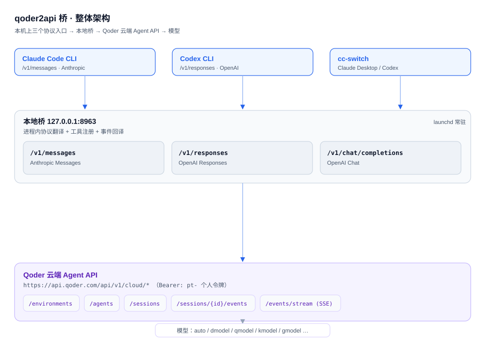
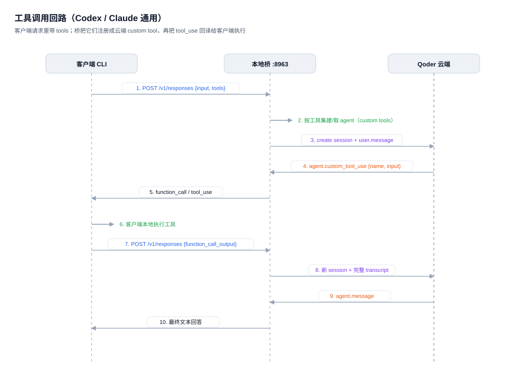
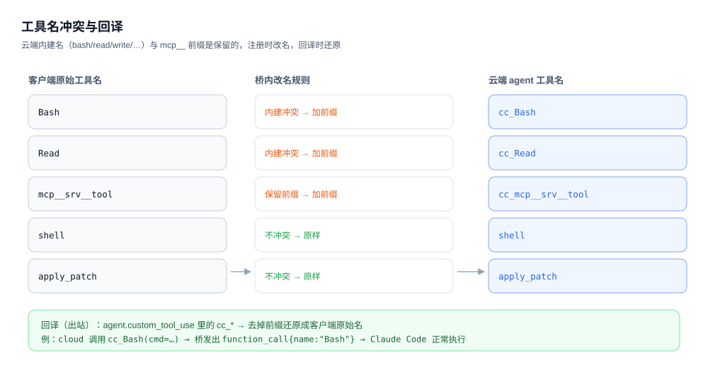
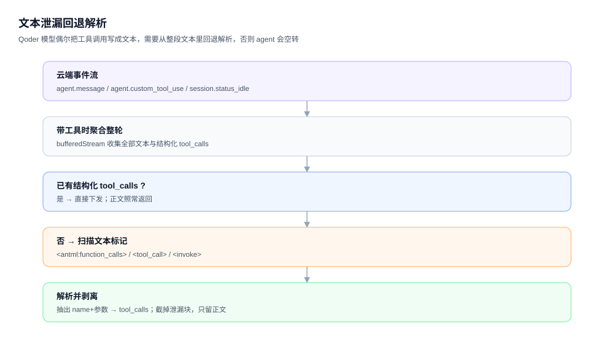

# qoder2api

[English](README.md)

Go 语言实现的协议桥，将 Qoder 暴露为 OpenAI 兼容和 Anthropic 兼容的本地 API。

支持的端点：

- `POST /v1/chat/completions` — OpenAI Chat Completions
- `POST /v1/responses` — OpenAI Responses（Codex CLI 使用）
- `POST /v1/messages` — Anthropic Messages（Claude Code CLI 使用）

## 快速开始

```bash
# 1. 登录授权（仅首次或 token 过期时需要）
go run ./cmd/qoder2api-login

# 2. 启动服务
go run ./cmd/qoder2api

# 3. 配置客户端指向 http://127.0.0.1:8963
```

## 授权

### CLI 登录（推荐）

```bash
go run ./cmd/qoder2api-login
```

浏览器会自动打开 Qoder 授权页面，完成登录后 token 自动保存到 `~/.config/qoder2api/auth.json`。之后直接启动服务即可，无需设置环境变量。

自定义保存路径：

```bash
go run ./cmd/qoder2api-login -o /path/to/auth.json
```

### QODER_AUTH_JSON

兼容模式，使用从 Qoder 客户端导出的 auth JSON：

```bash
QODER_AUTH_JSON=/absolute/path/to/auth.json go run ./cmd/qoder2api
```

支持的 JSON 格式：

- 包含 `securityOauthToken` 和 `refreshToken` 的根对象
- 包含 `auth_user_info_raw` 的根对象
- 第一个元素包含 `auth_user_info_raw` 的数组

### QODER_PAT

Cloud Agents API 模式：

```bash
QODER_PAT=your_pat go run ./cmd/qoder2api
```

## 运行

默认监听地址：

```text
http://127.0.0.1:8963
```

可选环境变量：

| 变量 | 说明 | 默认值 |
|------|------|--------|
| `QODER_HOST` | 监听地址 | `127.0.0.1` |
| `QODER_PORT` | 监听端口 | `8963` |
| `QODER_MODEL` | 默认模型 | `auto` |
| `QODER_TIMEOUT_SEC` | 请求超时（秒） | `300` |
| `QODER_BASE_URL` | Qoder API 地址 | `https://api.qoder.com` |
| `QODER_WORKSPACE_ROOT` | 工作区路径 | 空 |
| `QODER_PROXY_URL` | HTTP 代理 | 空 |
| `QODER_CA_FILE` | 自定义 CA 证书 | 空 |
| `QODER_INSECURE_SKIP_VERIFY` | 跳过 TLS 验证 | `false` |

## Docker

PAT 模式：

```bash
QODER_PAT=your_pat docker compose up --build
```

Auth JSON 模式：

```bash
docker build -t qoder2api:local .
docker run --rm -p 8963:8963 \
  -e QODER_HOST=0.0.0.0 \
  -e QODER_AUTH_JSON=/auth.json \
  -v /absolute/path/to/auth.json:/auth.json:ro \
  qoder2api:local
```

## 客户端配置

### Codex CLI

Codex 使用 Responses API，base URL 需要以 `/v1` 结尾。

编辑 `~/.codex/config.toml`：

```toml
[model_providers.custom]
name = "custom"
wire_api = "responses"
base_url = "http://127.0.0.1:8963/v1"
```

### Claude Code CLI

```bash
ANTHROPIC_BASE_URL=http://127.0.0.1:8963 ANTHROPIC_API_KEY=test-key claude
```

如果设置覆盖了 base URL，使用 `--setting-sources local`。

## 兼容性说明

- `QODER_AUTH_JSON` 使用基于官方 Qoder 客户端流量的兼容后端，上游客户端/API 变更可能需要更新
- 使用 `QODER_AUTH_JSON` 时建议 `QODER_MODEL=auto`，除非你已验证特定模型 key
- Anthropic `thinking` 块仅在请求显式启用时暴露
- `/v1/messages` 对于不使用客户端工具的图片流式传输，使用兼容回退模式：聚合上游结果后发出合法的 Anthropic SSE

## 开发

```bash
go test ./...
go build -o qoder2api ./cmd/qoder2api
```

## 免责声明

本项目（含本 fork 的改动）是**基于对 Qoder 客户端/接口的逆向实现**，属于非官方第三方工具，与 Qoder、阿里巴巴无任何关联，也未经其授权或认可。

**仅供学习和研究目的使用，使用者需自行承担风险。** 作者不对因使用本软件而产生的任何后果负责，包括但不限于账号封禁、额度清零、数据丢失或法律纠纷。

- 请勿用于任何商业用途，或以任何违反 Qoder 及第三方服务条款的方式使用。
- 逆向桥可能违反上游服务条款，**存在账号被限制或封禁的风险**，是否使用请自行评估。
- Auth JSON / token 文件包含有效凭据，**请勿提交到版本控制系统**。本 fork 会把 `pt-` 令牌以**明文**写入 launchd 的 plist 和本地客户端配置，请注意本机安全与备份。
- 桥默认只监听 `127.0.0.1`，且**不校验入站 API key**；请勿改成监听局域网/公网，也不要对外暴露该端口。
- 上游接口随时可能变更，本项目不保证持续可用。

## 许可证

[MIT](LICENSE)

## 实现原理

> 本仓库在 `jyao0708/qoder2api` 基础上补齐了 **Claude Code CLI** 与 **Codex CLI** 的真实可用性（工具调用链路）。下面逐条说明每个机制。

### 1. 整体架构



桥只监听 `127.0.0.1:8963`，对外暴露三个协议入口；所有上游请求带 `pt-` 个人令牌打到 Qoder 云端 Agent API。

| 层 | 内容 |
| --- | --- |
| 客户端 | Claude Code CLI（Anthropic Messages）、Codex CLI（OpenAI Responses）、cc-switch 托管的 Claude Desktop / Codex |
| 本地桥 | `127.0.0.1:8963`：协议翻译 + 工具注册 + 事件回译，`launchd` 常驻 |
| 云端 | `/environments`、`/agents`、`/sessions`、`/sessions/{id}/events`、`/events/stream`（SSE） |
| 模型 | `auto / dmodel / qmodel / kmodel / gmodel / …` |

### 2. 工具调用回路



关键点：**云端 agent 必须"认识"客户端要用的工具**，否则模型只会把调用写成文本、客户端收不到。

1. 客户端请求（`/v1/responses`、`/v1/messages`）里带 `tools`。
2. 桥按**工具集指纹**建或复用云端 agent：`sha256(model + tools)[:8]` 作为缓存键，同一套工具只建一次。
3. 桥创建 session，并把对话转录成一条 `user.message`。
4. 云端返回 `agent.custom_tool_use {name, input}` —— 注意事件名是 `custom_tool_use`，不是 `tool_use`。
5. 桥回译成客户端认识的 `function_call` / `tool_use`。
6. 客户端**在本地执行**工具（文件、shell 都由客户端做，桥不接管执行）。
7. 客户端把结果（`function_call_output` / `tool_result`）带回桥。
8. 桥开新 session，把**含历史 `tool_calls` / `tool_call_id` 的完整转录**再发一次。
9. 云端返回 `agent.message`。
10. 桥下发最终文本。

### 3. 工具注册与命名冲突



云端 agent 自带一批工具名（`bash/read/write/edit/glob/grep/webfetch/web_search`），`mcp__` 前缀又保留给 MCP，两者都不能直接用作 custom tool 名。于是：

- 命中内建名或 `mcp__` 前缀 → 加 `cc_` 前缀注册；
- 出站回译时去掉前缀，还原成客户端原始名；
- 不冲突的名字原样保留。

这样 Claude Code 的 `Bash/Read/Write/…`、Codex 的 `mcp__*` 都能正常往返。

### 4. 文本泄漏回退解析



Qoder 的模型偶尔把工具调用**当普通文本输出**（`<antml:function_calls>`、`<tool_call>`）。此时没有 `agent.custom_tool_use` 事件，客户端收不到调用，agent 空转。

做法：带工具时把上游事件**聚合整轮**；若结尾没有结构化 `tool_calls`，就从文本里回退解析：

- 形式一：`<antml:invoke name="X"><antml:parameter name="K">V</antml:parameter></antml:invoke>`
- 形式二：`<tool_call>NAME <arg_value>k: v</arg_value>…</tool_call>`

解析出 `name + 参数` 后**截掉泄漏块**（只保留正文），再按结构化 `tool_calls` 下发。

> 代价：带工具时整轮聚合，所以工具场景下没有逐字流式；纯聊天仍保留流式。

### 5. 模型回落

云端只接受官方模型 key，而客户端发来的是 `claude-sonnet-5`、`gpt-6.1-sol` 这类名字，直接注册会 400。因此：

- 命中 `knownQoderModels` → 原样使用；
- 否则回落到 `QODER_MODEL`（默认 `auto`）。

想固定模型，把 `QODER_MODEL` 设成 `dmodel` / `qmodel` / … 即可。

### 6. 关键源码

| 文件 | 作用 |
| --- | --- |
| `internal/qoder/cloud.go` | 云端后端：agent 缓存、工具注册、事件回译、文本回退解析 |
| `internal/qoder/backend.go` | 后端选择（PAT → Cloud Agents，否则 legacy） |
| `internal/bridge/messages.go` | Anthropic Messages 协议编解码 |
| `internal/bridge/responses.go` | OpenAI Responses 协议编解码 |
| `internal/bridge/handler.go` | 三个入口路由 |
| `internal/bridge/util.go` | 工具定义归一化 |
| `scripts/claude.sh` / `scripts/codex.sh` | 两个 CLI 的启动包装 |

## 用法

### 用 Claude Code CLI

```bash
scripts/claude.sh -p "用 bash 写一个文件并读回"
```

等价于：

```bash
ANTHROPIC_BASE_URL=http://127.0.0.1:8963 ANTHROPIC_API_KEY=qoder-local claude
```

### 用 Codex CLI

```bash
scripts/codex.sh exec "用 shell 运行 echo hi"
```

等价于：

```bash
OPENAI_API_KEY=qoder-local codex \
  -c model_provider=custom \
  -c 'model_providers.custom.base_url="http://127.0.0.1:8963/v1"' \
  -c 'model_providers.custom.wire_api="responses"' \
  -c 'model_providers.custom.requires_openai_auth=false'
```

### 已验证

- `codex exec`：真实执行 shell、写文件并读回（多次通过）。
- `claude -p`：用 Bash 工具写文件并读回（多次通过）。
